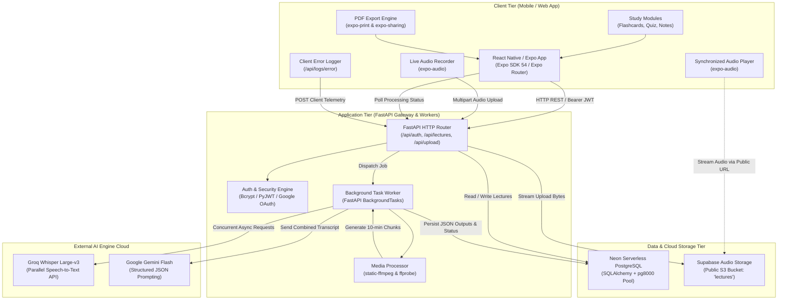
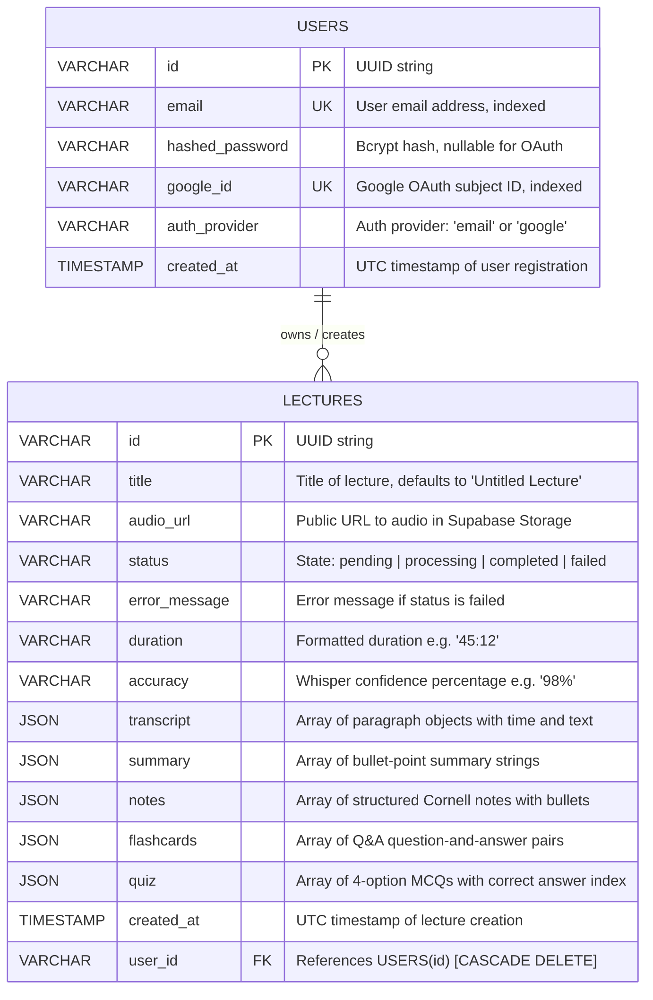
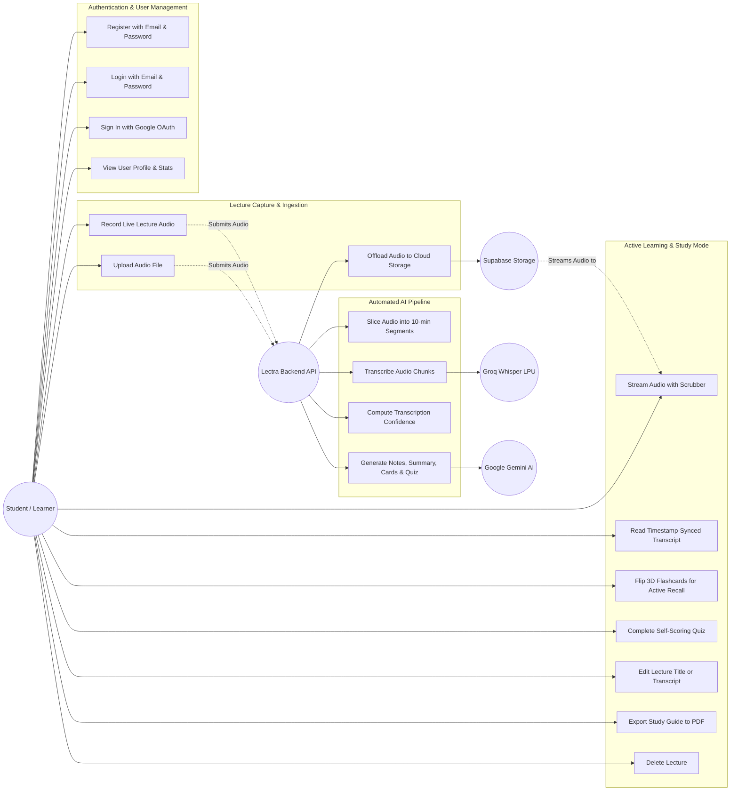
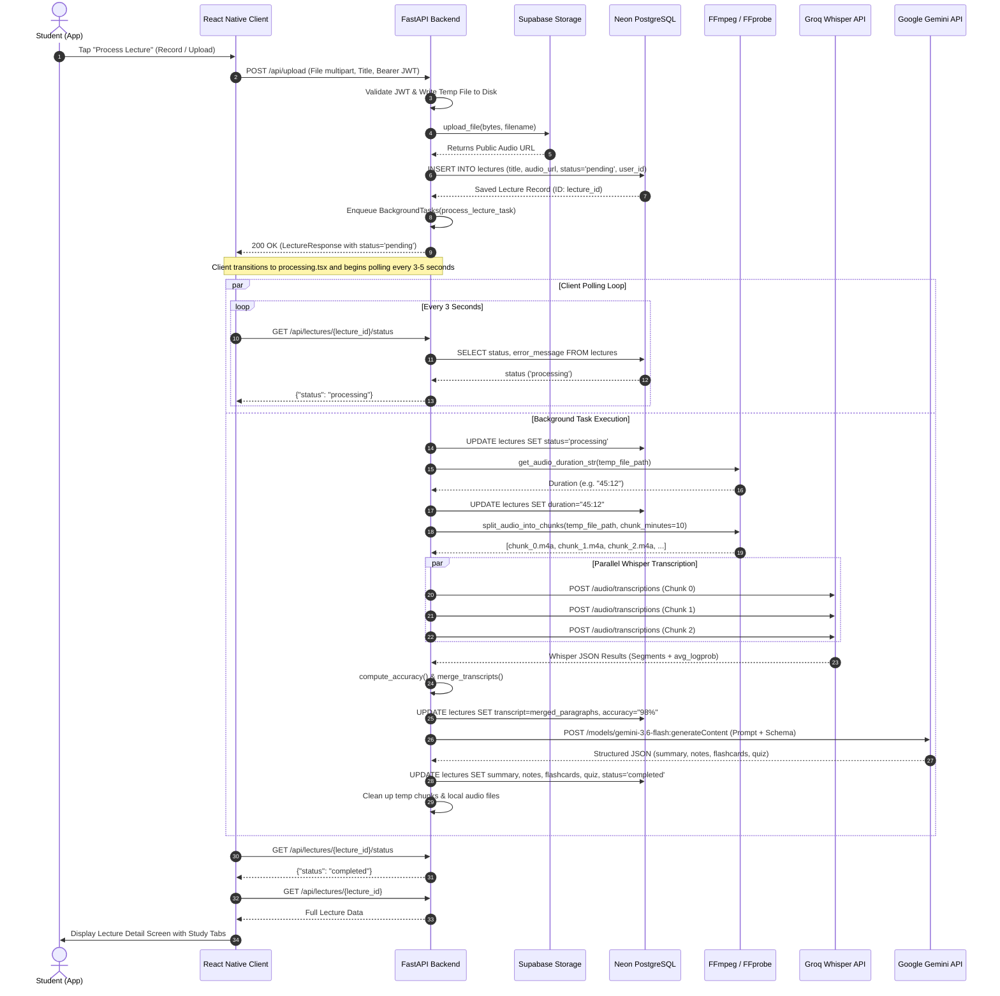
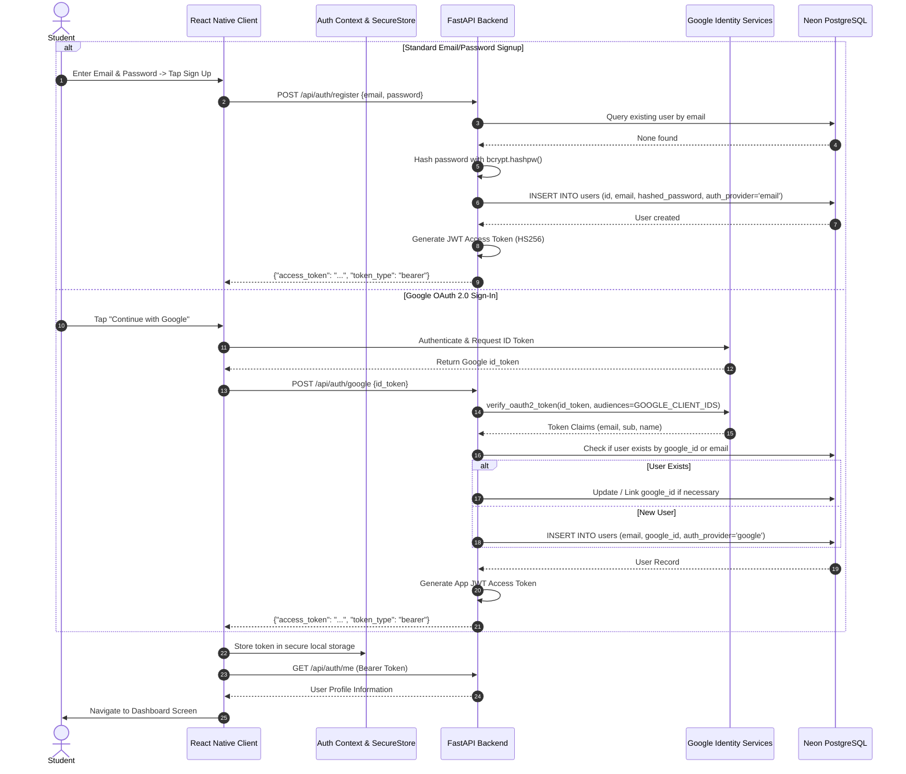
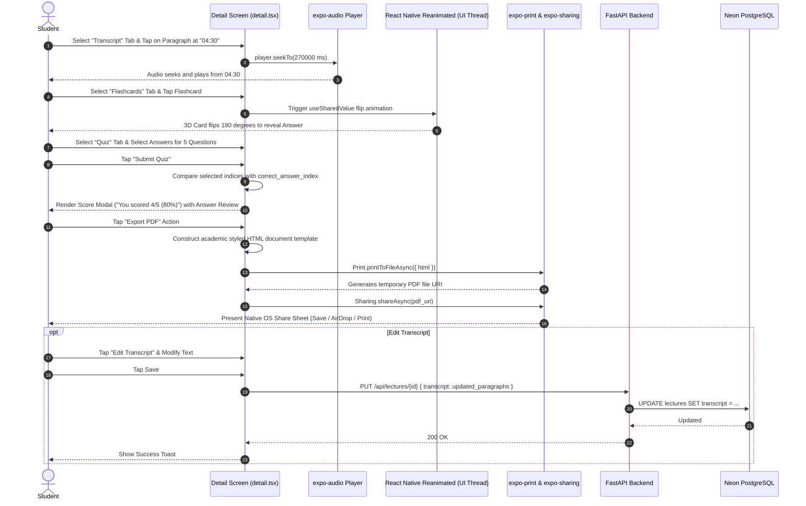

# Lectra AI — System Architecture & Technical Documentation

Lectra AI (also known as LecVoice AI) is an intelligent lecture companion and multimodal study platform. It enables students, researchers, and professionals to record or upload lectures, automatically transcribe speech with high accuracy, and synthesize structured learning materials—including executive summaries, Cornell-style structured notes, interactive 3D flip flashcards, and self-assessment quizzes—powered by state-of-the-art AI.

---

## Table of Contents

1. [High-Level Design (HLD) & Architecture](#1-high-level-design-hld--architecture)
   - [Architectural Overview](#architectural-overview)
   - [System Architecture Diagram](#system-architecture-diagram)
   - [Core Components Breakdown](#core-components-breakdown)
   - [Technology Stack Matrix](#technology-stack-matrix)
2. [Entity-Relationship (ER) Diagram](#2-entity-relationship-er-diagram)
   - [Database Schema Representation](#database-schema-representation)
   - [Data Dictionary & JSON Schemas](#data-dictionary--json-schemas)
   - [Relational Integrity & Indexes](#relational-integrity--indexes)
3. [Use Case Diagram & System Actor Specifications](#3-use-case-diagram--system-actor-specifications)
   - [System Actors](#system-actors)
   - [Mermaid Use Case Diagram](#mermaid-use-case-diagram)
   - [Core Use Case Specifications](#core-use-case-specifications)
4. [Sequence Diagrams](#4-sequence-diagrams)
   - [Sequence 1: End-to-End Lecture Ingestion & AI Processing](#sequence-1-end-to-end-lecture-ingestion--ai-processing)
   - [Sequence 2: User Authentication & Token Exchange](#sequence-2-user-authentication--token-exchange)
   - [Sequence 3: Interactive Study, Quiz Evaluation & PDF Export](#sequence-3-interactive-study-quiz-evaluation--pdf-export)
5. [How It Works (Deep-Dive Execution Pipeline)](#5-how-it-works-deep-dive-execution-pipeline)
   - [Phase 1: Ingestion & Cloud Asset Offloading](#phase-1-ingestion--cloud-asset-offloading)
   - [Phase 2: Audio Probing & Lossless Chunking](#phase-2-audio-probing--lossless-chunking)
   - [Phase 3: Concurrent Speech-to-Text with Groq Whisper](#phase-3-concurrent-speech-to-text-with-groq-whisper)
   - [Phase 4: Timestamp Normalization & Accuracy Calculation](#phase-4-timestamp-normalization--accuracy-calculation)
   - [Phase 5: Structured Study Material Synthesis via Gemini](#phase-5-structured-study-material-synthesis-via-gemini)
   - [Phase 6: Real-time Client Polling & Hydration](#phase-6-real-time-client-polling--hydration)
   - [Phase 7: Client-Side Interactive Study Engines](#phase-7-client-side-interactive-study-engines)
6. [API Specification & Data Contracts](#6-api-specification--data-contracts)
   - [Authentication Endpoints](#authentication-endpoints)
   - [Lecture Management Endpoints](#lecture-management-endpoints)
   - [Diagnostics & Observability](#diagnostics--observability)
7. [Security, Scalability & Resilience](#7-security-scalability--resilience)

---

## 1. High-Level Design (HLD) & Architecture

### Architectural Overview

Lectra AI follows a modern decoupled client-server architecture:
- **Client Tier**: Cross-platform mobile client built using **React Native** and **Expo SDK 54** (with Expo Router file-based navigation, Expo Audio, and React Native Reanimated).
- **Application / API Tier**: A high-throughput asynchronous **FastAPI** application running on Python 3.11+, providing RESTful APIs, JWT authentication, and background worker task queues.
- **Media Processing Layer**: Built-in integration with `static-ffmpeg` and `ffprobe` for audio inspection and zero-re-encoding stream slicing.
- **AI Speech Recognition Tier**: **Groq Whisper Large-v3** running on specialized LPU (Language Processing Unit) hardware for ultra-fast, concurrent transcription.
- **AI Cognition & Generation Tier**: **Google Gemini Flash** invoked with strict JSON response schemas to generate structured pedagogical materials.
- **Data & Object Storage Tier**: **Neon Serverless PostgreSQL** for transactional records, and **Supabase Storage** (S3-compatible bucket) for persistent audio asset hosting.

---

### System Architecture Diagram



---

### Core Components Breakdown

1. **Expo Mobile Client (`app/`)**:
   - `app/(auth)`: Handles email/password sign-up, login, and Google Sign-In with automatic JWT token storage.
   - `app/(tabs)`: Core navigation housing `index.tsx` (Dashboard & Recent Lectures), `record.tsx` (live audio capture), `upload.tsx` (document & file picker), and `profile.tsx` (user settings).
   - `app/detail.tsx`: Master multi-tab lecture review screen supporting audio playback scrubber, synchronized transcripts, Cornell notes, 3D animated flip cards, interactive self-scoring quiz, transcript editing, and PDF exports.
   - `app/processing.tsx`: Real-time status polling interface with animated progress indicators.

2. **FastAPI Application Gateway (`backend/main.py`)**:
   - Manages synchronous API endpoints, input validation using Pydantic models, and security middleware (CORS, Bearer HTTP tokens).
   - Exposes client diagnostic logging at `/api/logs/error` for automated crash telemetry.

3. **Audio Splitting & Duration Engine (`backend/audio_processor.py`)**:
   - Incorporates `static-ffmpeg` to bundle FFmpeg and FFprobe binaries without host-level dependencies.
   - Extracts precise duration metadata via `ffprobe` JSON format inspection.
   - Executes time-indexed segment extraction (`-ss` and `-t` with `-c copy`) to segment long lectures into 10-minute slices without audio transcoding loss.

4. **Speech Recognition Worker (`backend/transcriber.py`)**:
   - Dispatches audio chunks concurrently to Groq's high-speed Whisper-large-v3 model using `httpx.AsyncClient` and `asyncio.gather`.
   - Normalizes and re-indexes segment timestamps across chunk boundaries.
   - Computes an aggregate transcription confidence score using exponentiated segment log-probabilities (`math.exp(avg_logprob)`).

5. **Pedagogical AI Generator (`backend/ai_generator.py`)**:
   - Calls Google's Gemini API with a prompt enforcing academic study structures.
   - Enforces a strict response schema (`responseMimeType="application/json"`) returning JSON structures for:
     - `summary`: Bulleted list of takeaways.
     - `notes`: Concept sections with titles and sub-bullet points.
     - `flashcards`: Question/answer pairs for active recall.
     - `quiz`: Multiple-choice questions with 4 options and 0-indexed correct answers.

6. **Database & Storage Services (`backend/database.py`, `backend/storage.py`)**:
   - Connection-managed integration with Neon PostgreSQL utilizing the pure-Python `pg8000` driver, SSL verification, and connection pre-ping recycling.
   - Supabase Python SDK client handling direct multipart upload of audio assets into public cloud storage.

---

### Technology Stack Matrix

| Domain | Technology / Library | Version / Specification | Purpose |
| :--- | :--- | :--- | :--- |
| **Mobile Client** | React Native / Expo | Expo SDK 54 | Cross-platform mobile client (iOS / Android / Web) |
| **Navigation** | Expo Router | v4.x (File-based routing) | Deep linking and modal/tab routing |
| **Animations** | React Native Reanimated | v3.x | 60/120fps 3D card flips and UI transitions |
| **Audio Engine** | `expo-audio` | SDK 54 Native Module | Audio recording and cloud streaming playback |
| **Export Engine** | `expo-print`, `expo-sharing` | Native Expo APIs | Dynamic HTML-to-PDF rendering and native sharing |
| **Backend Framework** | FastAPI | 0.115+ | High-performance asynchronous API server |
| **ASGI Server** | Uvicorn | Standard | Asynchronous HTTP server implementation |
| **Database ORM** | SQLAlchemy | 2.0+ (Declarative) | Object-Relational Mapping & schema management |
| **PostgreSQL Driver** | `pg8000` | Pure-Python DBAPI | SSL-enforced serverless Neon PostgreSQL connectivity |
| **Audio Tooling** | `static-ffmpeg` / `ffprobe` | Standalone binaries | Zero-dependency duration calculation & chunk slicing |
| **Transcription AI** | Groq Cloud API | `whisper-large-v3` | High-throughput LPU-accelerated speech-to-text |
| **Cognitive AI** | Google Gemini API | `gemini-3.6-flash` / `1.5-flash` | Structured JSON generation for study resources |
| **Cloud Storage** | Supabase Storage | S3-Compatible API | Secure hosting of lecture audio recordings |
| **Authentication** | PyJWT, Passlib/Bcrypt, Google Auth | HS256, OAuth 2.0 | Passwords, JWT tokens & Google identity verification |

---

## 2. Entity-Relationship (ER) Diagram

### Database Schema Representation

The application employs a relational PostgreSQL database hosted on Neon. The schema is organized around two primary entities: **`User`** and **`Lecture`**.



---

### Data Dictionary & JSON Schemas

#### 1. Entity: `users`
Represents registered students and users within the system.

| Column | Data Type | Constraints | Description |
| :--- | :--- | :--- | :--- |
| `id` | `VARCHAR` | Primary Key, Non-Null | Unique UUIDv4 identifier string. |
| `email` | `VARCHAR` | Unique, Non-Null, Indexed | User email address used for login and notifications. |
| `hashed_password` | `VARCHAR` | Nullable | Bcrypt password hash. Nullable when registering via Google OAuth. |
| `google_id` | `VARCHAR` | Unique, Nullable, Indexed | Google Subject ID (`sub`) extracted from verified Google ID tokens. |
| `auth_provider` | `VARCHAR` | Non-Null, Default: `'email'` | Indicates identity source (`'email'` or `'google'`). |
| `created_at` | `TIMESTAMP` | Non-Null | UTC timestamp of record creation. |

#### 2. Entity: `lectures`
Represents a recorded or uploaded audio lecture along with its transcript and all generated study assets.

| Column | Data Type | Constraints | Description |
| :--- | :--- | :--- | :--- |
| `id` | `VARCHAR` | Primary Key, Non-Null | Unique UUIDv4 identifier string. |
| `title` | `VARCHAR` | Non-Null | User-customizable title of the lecture session. |
| `audio_url` | `VARCHAR` | Non-Null | Public HTTPS URL for streaming audio from Supabase Storage. |
| `status` | `VARCHAR` | Non-Null, Default: `'pending'` | Processing state: `'pending'`, `'processing'`, `'completed'`, or `'failed'`. |
| `error_message` | `VARCHAR` | Nullable | Descriptive failure message if the background task errors out. |
| `duration` | `VARCHAR` | Nullable | Human-readable audio duration string (e.g. `"18:45"` or `"01:12:30"`). |
| `accuracy` | `VARCHAR` | Nullable | Calculated transcription confidence rating (e.g. `"97%"`). |
| `transcript` | `JSON` | Nullable | Structured JSON containing timestamped text paragraphs. |
| `summary` | `JSON` | Nullable | Structured JSON array containing executive summary points. |
| `notes` | `JSON` | Nullable | Structured JSON array containing Cornell-style note headings & bullets. |
| `flashcards` | `JSON` | Nullable | Structured JSON array containing question/answer study cards. |
| `quiz` | `JSON` | Nullable | Structured JSON array containing multiple-choice quiz questions. |
| `created_at` | `TIMESTAMP` | Non-Null | UTC timestamp of initial upload. |
| `user_id` | `VARCHAR` | Foreign Key -> `users.id` | Ownership link. Automatically deleted when user is deleted. |

#### JSON Column Specifications in `lectures`

- **`transcript`**:
  ```json
  [
    {
      "time": "00:00",
      "text": "Welcome to today's lecture on Cellular Biology and ATP synthesis..."
    },
    {
      "time": "01:30",
      "text": "In this next section, we examine the inner mitochondrial membrane..."
    }
  ]
  ```

- **`summary`**:
  ```json
  [
    "Cellular respiration converts glucose and oxygen into usable ATP energy.",
    "Glycolysis takes place in the cytoplasm and yields a net gain of 2 ATP.",
    "The Krebs cycle and oxidative phosphorylation occur in the mitochondria."
  ]
  ```

- **`notes`**:
  ```json
  [
    {
      "title": "Glycolysis",
      "bullets": [
        "Anaerobic metabolic pathway occurring in the cytosol.",
        "Breaks down one 6-carbon glucose molecule into two 3-carbon pyruvates.",
        "Consumes 2 ATP, produces 4 ATP, resulting in a net yield of 2 ATP."
      ]
    }
  ]
  ```

- **`flashcards`**:
  ```json
  [
    {
      "q": "What is the primary site of oxidative phosphorylation?",
      "a": "The inner mitochondrial membrane."
    },
    {
      "q": "What enzyme facilitates the synthesis of ATP during chemiosmosis?",
      "a": "ATP Synthase."
    }
  ]
  ```

- **`quiz`**:
  ```json
  [
    {
      "question": "What is the net ATP yield of glycolysis per glucose molecule?",
      "options": ["1 ATP", "2 ATP", "4 ATP", "36 ATP"],
      "correct_answer_index": 1
    }
  ]
  ```

---

### Relational Integrity & Indexes

1. **Foreign Key Cascade**:
   - `lectures.user_id` references `users.id`.
   - Defined with `cascade="all, delete-orphan"` in SQLAlchemy, ensuring user deletion automatically removes all associated lecture recordings and transcripts.
2. **Database Indices**:
   - `ix_users_email`: B-Tree index on `users.email` for $O(1)$ authentication lookups.
   - `ix_users_google_id`: Partial unique index on `users.google_id WHERE google_id IS NOT NULL` to enforce uniqueness across Google-authenticated accounts while allowing multiple nulls for email accounts.
3. **Database Connection Strategy**:
   - Handled via `SessionLocal` with `pool_pre_ping=True` and connection recycling (`pool_recycle=300`) to guarantee connection resilience against Neon serverless idle disconnects.

---

## 3. Use Case Diagram & System Actor Specifications

### System Actors

1. **Student / Learner (Primary Actor)**:
   - Authenticates into the application.
   - Records live classroom lectures or uploads pre-recorded lecture files.
   - Reviews transcripts, reads summaries, studies Cornell notes.
   - Interacts with 3D flashcards and tests comprehension with quizzes.
   - Edits transcripts or titles, deletes old lectures, and exports study guides to PDF.
2. **Backend Application Server (FastAPI System)**:
   - Validates tokens, handles file streaming, and persists database records.
   - Manages asynchronous background worker pipelines.
3. **Groq Whisper Cloud (Secondary Actor / External Service)**:
   - Receives partitioned audio chunks and delivers high-speed transcribed segments with timestamps and log probabilities.
4. **Google Gemini AI (Secondary Actor / External Service)**:
   - Processes the merged lecture transcript and synthesizes structured study artifacts matching the target JSON schema.
5. **Supabase Object Storage (Secondary Actor / Cloud Service)**:
   - Stores raw audio files and serves them publicly for client playback.

---

### Mermaid Use Case Diagram



---

### Core Use Case Specifications

| Use Case ID | Name | Actor | Description | Preconditions | Postconditions |
| :--- | :--- | :--- | :--- | :--- | :--- |
| **UC-01** | Register / Login | Student | Create an account or sign in with credentials or Google OAuth. | None | JWT token stored in client storage. |
| **UC-02** | Record Live Lecture | Student | Record lecture audio directly from the device microphone. | Microphone permission granted. | Audio recorded in `.m4a` format. |
| **UC-03** | Upload Lecture Audio | Student | Select and upload an audio file (`.m4a`, `.mp3`, `.wav`) from file system. | Valid file selected (< 100MB). | Audio transmitted to `/api/upload`. |
| **UC-04** | Cloud Audio Ingestion | Backend | Offloads file bytes to Supabase Storage and creates `pending` DB record. | Valid audio file payload. | Public audio URL generated; DB row initialized. |
| **UC-05** | Media Slicing | Backend | Checks audio duration with FFprobe and splits into 10-minute segments. | Local audio copy available. | Segment chunk files created in temp storage. |
| **UC-06** | Parallel Transcription | Backend / Groq | Sends chunks concurrently to Groq Whisper and aggregates segments. | Valid Groq API key. | Consolidated raw text and word-level timestamps. |
| **UC-07** | Cognitive Study Generation | Backend / Gemini | Prompts Google Gemini with full transcript using strict JSON schema. | Valid Gemini API key. | Structured summary, notes, flashcards, and quiz saved to DB. |
| **UC-08** | Interactive Study | Student | Review study materials, flip flashcards, and attempt the quiz. | Lecture status is `completed`. | Instant visual feedback and test score calculated. |
| **UC-09** | Export to PDF | Student | Generates a formatted academic PDF study sheet with notes and quizzes. | Lecture data loaded in app. | PDF rendered and opened in OS share sheet. |
| **UC-10** | Modify Lecture Data | Student | Renames lecture or corrects transcription words. | Ownership of lecture. | Updated lecture record in database. |

---

## 4. Sequence Diagrams

### Sequence 1: End-to-End Lecture Ingestion & AI Processing

This sequence illustrates the end-to-end asynchronous workflow when a user uploads or records lecture audio until all AI study assets are fully generated and delivered.



---

### Sequence 2: User Authentication & Token Exchange

This diagram outlines both native Email/Password signup/login and Google OAuth 2.0 single sign-on.



---

### Sequence 3: Interactive Study, Quiz Evaluation & PDF Export

This sequence demonstrates how user interactions in the lecture detail screen trigger audio synchronization, card flip animations, quiz evaluation, and PDF document generation.



---

## 5. How It Works (Deep-Dive Execution Pipeline)

Lectra AI processes lecture recordings through a resilient 7-phase pipeline designed to handle audio files ranging from brief 2-minute memos to 2-hour university lectures.

```
┌────────────────────────────────────────────────────────────────────────────────────────┐
│                                LECTRA AI PROCESSING PIPELINE                           │
└────────────────────────────────────────────────────────────────────────────────────────┘
       [1] Ingest & Upload ───► Supabase Cloud Storage (Public URL)
                │
                ▼
       [2] Media Probing   ───► FFprobe Duration Discovery & static-ffmpeg Slicing
                │               (10-Minute Boundary Chunking without Re-encoding)
                ▼
       [3] High-Speed ASR  ───► Concurrent Groq Whisper-large-v3 Transcription
                │               (Async HTTP Gather with Fallback Handling)
                ▼
       [4] Harmonization   ───► Timestamp Re-indexing & Confidence Scoring
                │               (Confidence = exp(weighted_avg(logprob)) * 100)
                ▼
       [5] Generative AI   ───► Google Gemini Flash Structured Analysis
                │               (Strict JSON Schema: Summary, Notes, Flashcards, Quiz)
                ▼
       [6] Persistence     ───► Atomic DB Commit (Neon Serverless PostgreSQL)
                │
                ▼
       [7] Interactive App ───► Real-Time Polling & Hydration into Study Center
```

---

### Phase 1: Ingestion & Cloud Asset Offloading
1. When a user records audio via `expo-audio` or selects a file through the document picker, the client creates a `multipart/form-data` request targeting `POST /api/upload`.
2. The FastAPI endpoint validates the caller's JWT token, opens a streaming file buffer, and writes a temporary local file copy to the operating system's temp directory (`tempfile.gettempdir()`).
3. The binary bytes are transmitted to **Supabase Storage** under the `lectures` bucket with an enforced MIME type (`audio/x-m4a` or `audio/mpeg`). Supabase provides a permanent public HTTPS URL.
4. A database record is immediately inserted into Neon PostgreSQL with `status="pending"`. The endpoint returns HTTP 200 with the lecture metadata, offloading heavy processing to an asynchronous FastAPI background task.

### Phase 2: Audio Probing & Lossless Chunking
1. The background worker (`process_lecture_task`) initializes an independent SQLAlchemy session.
2. The media engine calls `audio_processor.get_audio_duration_str()`, which invokes `ffprobe` in quiet JSON output mode:
   ```bash
   ffprobe -v quiet -print_format json -show_format <file_path>
   ```
   The exact duration in seconds is extracted and formatted into human-readable notation (`MM:SS` or `HH:MM:SS`), and committed to the database.
3. If the audio exceeds 10 minutes (600,000 milliseconds), `split_audio_into_chunks()` divides the file into 10-minute segments using FFmpeg's stream-copy mode:
   ```bash
   ffmpeg -y -i <input_file> -ss <start_sec> -t 600 -c copy <chunk_output.m4a>
   ```
   Using `-c copy` bypasses audio re-encoding, allowing chunking to execute in milliseconds with zero acoustic degradation.

### Phase 3: Concurrent Speech-to-Text with Groq Whisper
1. Standard Whisper implementations process audio sequentially. Lectra AI accelerates this by dispatching all 10-minute audio chunks simultaneously to the **Groq Whisper API** using `asyncio.gather` and `httpx.AsyncClient`.
2. Groq's specialized LPU hardware transcribes each chunk using the `whisper-large-v3` model with `response_format="verbose_json"`, completing 10-minute audio chunks in roughly 2 to 4 seconds.
3. Each chunk response includes raw segment-level text, chunk-relative start/end timestamps, and segment token average log probabilities (`avg_logprob`).

### Phase 4: Timestamp Normalization & Accuracy Calculation
1. **Timestamp Normalization**: For each chunk $i$ (where $i \ge 0$), a time offset of $i \times 600\text{ seconds}$ is added to all segment boundaries:
   $$\text{Global Start} = \text{Segment Start} + (i \times 600)$$
   $$\text{Global End} = \text{Segment End} + (i \times 600)$$
2. **Confidence Metric Calculation**: Transcription accuracy is calculated mathematically from Whisper's segment log probabilities. Because log probabilities represent $\ln(P)$, the model's confidence is computed via duration-weighted exponentiation:
   $$\text{Confidence} = \exp\left( \frac{\sum ( \text{avg\_logprob}_j \times \text{duration}_j )}{\sum \text{duration}_j} \right) \times 100$$
   This yields an accurate percentage rating (e.g., `98%`) stored directly in `lectures.accuracy`.
3. **Paragraph Harmonization**: Individual fragments are aggregated into coherent study paragraphs of 1.5 to 2 minutes each, tagged with clean timestamp cues (`[{"time": "02:15", "text": "..."}]`).

### Phase 5: Structured Study Material Synthesis via Gemini
1. The unified transcript is forwarded to **Google Gemini Flash** using an academic study assistant prompt.
2. Lectra AI forces Gemini to use Google's native JSON Schema validation (`responseSchema` and `responseMimeType="application/json"`). This prevents Markdown syntax errors or conversational filler from breaking parsing.
3. Gemini outputs:
   - **Executive Summary**: 5–8 bullet points capturing core principles.
   - **Cornell Notes**: Thematic sections with concept titles and detailed analytical bullets.
   - **Flashcards**: 10–20 comprehensive question-and-answer pairs for spaced repetition.
   - **Quiz**: 10–20 four-option multiple choice questions with correct index mapping.

### Phase 6: Real-time Client Polling & Hydration
1. The background worker persists the generated JSON fields into the `lectures` row, updates `status="completed"`, and cleans up all temporary audio chunks from local storage.
2. In the mobile client, `app/processing.tsx` polls `GET /api/lectures/{id}/status` every 3 seconds.
3. Upon detecting `status="completed"`, the client performs a full fetch via `GET /api/lectures/{id}` and seamlessly transitions to `app/detail.tsx`.

### Phase 7: Client-Side Interactive Study Engines
- **Audio Scrubber**: Powered by `expo-audio`, tapping any timestamp in the transcript automatically seeks playback to that exact point in time.
- **3D Card Flip**: Built with `react-native-reanimated` using a shared value animating from $0^\circ$ to $180^\circ$ with perspective transformation, providing fluid physical card flips on tap.
- **Interactive Quiz**: Evaluates student choices in real-time, displays score breakdowns, and highlights correct answers.
- **Print & Share**: Converts the lecture's structured notes and quizzes into a styled HTML document and utilizes `expo-print` to output a clean PDF document for offline printing or native sharing.

---

## 6. API Specification & Data Contracts

All endpoints are served from the FastAPI backend (base URL: `http://<host>:8000` or production domain). Protected endpoints require the HTTP header:
`Authorization: Bearer <jwt_token>`

### Authentication Endpoints

#### 1. Register Account
- **Route**: `POST /api/auth/register`
- **Request Body**:
  ```json
  {
    "email": "student@university.edu",
    "password": "SecurePassword123"
  }
  ```
- **Response** (HTTP 200):
  ```json
  {
    "access_token": "eyJhbGciOiJIUzI1NiIsInR5cCI6IkpXVCJ9...",
    "token_type": "bearer"
  }
  ```

#### 2. User Login
- **Route**: `POST /api/auth/login`
- **Request Body**:
  ```json
  {
    "email": "student@university.edu",
    "password": "SecurePassword123"
  }
  ```
- **Response** (HTTP 200):
  ```json
  {
    "access_token": "eyJhbGciOiJIUzI1NiIsInR5cCI6IkpXVCJ9...",
    "token_type": "bearer"
  }
  ```

#### 3. Google OAuth 2.0 Sign-In
- **Route**: `POST /api/auth/google`
- **Request Body**:
  ```json
  {
    "id_token": "eyJhbGciOiJSUzI1NiIsImtpZCI6..."
  }
  ```
- **Response** (HTTP 200):
  ```json
  {
    "access_token": "eyJhbGciOiJIUzI1NiIsInR5cCI6IkpXVCJ9...",
    "token_type": "bearer"
  }
  ```

#### 4. Current User Profile
- **Route**: `GET /api/auth/me`
- **Headers**: `Authorization: Bearer <token>`
- **Response** (HTTP 200):
  ```json
  {
    "id": "c39a5f4a-79a6-4b2e-a579-247071a995e1",
    "email": "student@university.edu",
    "created_at": "2026-09-18T14:32:00Z"
  }
  ```

---

### Lecture Management Endpoints

#### 1. Upload & Process Lecture
- **Route**: `POST /api/upload`
- **Content-Type**: `multipart/form-data`
- **Headers**: `Authorization: Bearer <token>`
- **Form Data**:
  - `file`: Binary audio file (`.m4a`, `.mp3`, `.wav`)
  - `title`: String (e.g. `"Neuroscience 101 — Synaptic Transmission"`)
- **Response** (HTTP 200):
  ```json
  {
    "id": "e8a7199c-29d0-4965-9eb9-73f1d898ef11",
    "title": "Neuroscience 101 — Synaptic Transmission",
    "audio_url": "https://xyz.supabase.co/storage/v1/object/public/lectures/e8a7199c.m4a",
    "status": "pending",
    "duration": null,
    "accuracy": null,
    "transcript": null,
    "summary": null,
    "notes": null,
    "flashcards": null,
    "quiz": null,
    "created_at": "2026-09-18T22:15:00Z",
    "user_id": "c39a5f4a-79a6-4b2e-a579-247071a995e1"
  }
  ```

#### 2. List All User Lectures
- **Route**: `GET /api/lectures`
- **Headers**: `Authorization: Bearer <token>`
- **Response** (HTTP 200): Array of `LectureResponse` objects ordered by creation date descending.

#### 3. Retrieve Full Lecture by ID
- **Route**: `GET /api/lectures/{lecture_id}`
- **Headers**: `Authorization: Bearer <token>`
- **Response** (HTTP 200): Complete `LectureResponse` with populated `transcript`, `summary`, `notes`, `flashcards`, and `quiz`.

#### 4. Poll Lecture Status
- **Route**: `GET /api/lectures/{lecture_id}/status`
- **Headers**: `Authorization: Bearer <token>`
- **Response** (HTTP 200):
  ```json
  {
    "id": "e8a7199c-29d0-4965-9eb9-73f1d898ef11",
    "status": "processing",
    "error_message": null
  }
  ```

#### 5. Update Lecture Title or Transcript
- **Route**: `PUT /api/lectures/{lecture_id}`
- **Headers**: `Authorization: Bearer <token>`
- **Request Body**:
  ```json
  {
    "title": "Updated Lecture Title",
    "transcript": [
      { "time": "00:00", "text": "Corrected opening paragraph..." }
    ]
  }
  ```
- **Response** (HTTP 200): Updated `LectureResponse`.

#### 6. Delete Lecture
- **Route**: `DELETE /api/lectures/{lecture_id}`
- **Headers**: `Authorization: Bearer <token>`
- **Response** (HTTP 200):
  ```json
  {
    "detail": "Lecture deleted successfully"
  }
  ```

---

### Diagnostics & Observability

#### 1. Ingest Client-Side Error Log
- **Route**: `POST /api/logs/error`
- **Request Body**:
  ```json
  {
    "message": "Audio playback failure",
    "stack": "Error: Player not initialized at detail.tsx:142",
    "componentStack": "in FlipCard in DetailScreen",
    "url": "/detail?id=e8a7199c",
    "platform": "ios",
    "timestamp": "2026-09-18T22:25:30Z"
  }
  ```
- **Response** (HTTP 200):
  ```json
  {
    "status": "success"
  }
  ```

---

## 7. Security, Scalability & Resilience

### 1. Data Security & Authentication
- **Password Protection**: User passwords are encrypted using `bcrypt` with salt rounds, ensuring protection against rainbow-table attacks.
- **JWT Cryptography**: Authentication tokens are signed using `HS256` with expiration cycles (30-day validity) and verified per-request via FastAPI's `HTTPBearer` dependency.
- **Google OAuth Verification**: Google ID tokens are verified cryptographically against Google's public keys via `google-auth`, ensuring tokens were issued for the configured client IDs (`GOOGLE_CLIENT_IDS`).
- **Resource Ownership Authorization**: Every data manipulation query explicitly filters on `user_id == current_user.id`, preventing horizontal privilege escalation or IDOR vulnerabilities.

### 2. Audio Processing Resilience
- **Zero-Dependency Portability**: By using `static-ffmpeg`, the backend dynamically provisions platform-native `ffmpeg` and `ffprobe` binaries on Linux/macOS/Windows environments without requiring OS-level package installations.
- **Stream-Copy Slicing**: Using FFmpeg with `-c copy` prevents CPU-heavy transcoding, enabling long files to be sliced in seconds.
- **Graceful File Cleanup**: All temporary audio files and intermediate chunk files are wrapped in `finally:` blocks to prevent disk leaks on worker nodes.

### 3. Database Scalability & Connection Management
- **Serverless PostgreSQL Optimization**: Neon serverless Postgres suspends idle compute nodes. The backend configures SQLAlchemy with `pool_pre_ping=True` and `pool_recycle=300` to automatically recover from dropped connections without raising HTTP 500 errors.
- **Low Connection Footprint**: Max pool size is capped at 5 connections with a max overflow of 2, fitting cleanly within free and entry-tier serverless limits.

### 4. Asynchronous Concurrency
- Long-running speech-to-text operations execute outside the main HTTP event loop using FastAPI's `BackgroundTasks`.
- Groq transcription calls run in parallel across chunks with `asyncio.gather`, keeping total processing time proportional to a single 10-minute chunk rather than the full lecture duration.
